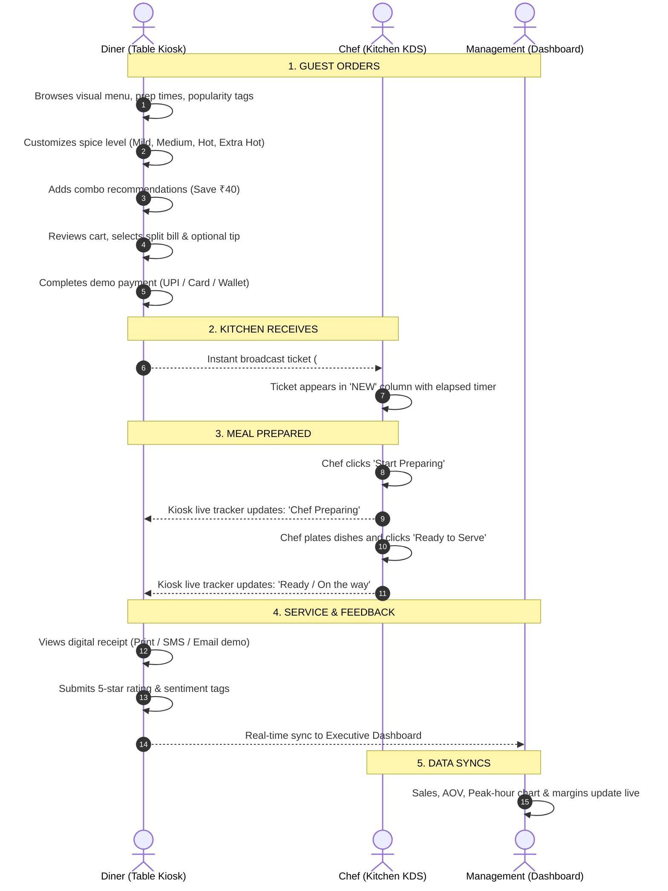

# OrderEase Kiosk — System Architecture & Flow

## Overview
OrderEase is a table-side smart self-ordering kiosk prototype developed for restaurant presentations. It connects the diner at the table, the kitchen staff on the line, and restaurant leadership in management in one unified, real-time reactive workflow.

---

## 1. End-to-End Business Flow

---

## 2. Technical Stack

| Tier | Technology | Purpose |
| :--- | :--- | :--- |
| **Frontend Framework** | React 19 + TypeScript + Vite | Ultra-fast rendering, strict type-safety |
| **Styling** | Tailwind CSS + Google Fonts (Outfit & Inter) | Tailored culinary aesthetic, tablet kiosk touch layout |
| **Icons** | Lucide React | High-contrast touch indicators |
| **State & Sync** | React Context + BroadcastChannel + LocalStorage | Zero-latency cross-tab and cross-screen live synchronization |
| **Backend API** | Python 3.11 + FastAPI + Pydantic | Lightweight microservice for cloud and POS integration |
| **Deployment** | HTTPS Cloud Tunnel + Vercel / Netlify configs | Public cloud URL for customer proposal review |

---

## 3. Tablet Responsive Design Matrix

The kiosk interface is purposefully crafted for restaurant tablet hardware:

- **10" to 12" Tablets (Landscape)**: Primary target device mounted on table docks. Two-column visual layout with touch targets larger than 48px.
- **8" to 10" Tablets (Portrait)**: Single-column scrollable grid with floating action drawer for instant cart review.
- **Desktop (1280px+)**: Multi-window presentation mode allows presenter to run Kiosk on left monitor and Kitchen KDS on right monitor.
- **Mobile (320px–767px)**: Handheld responsive ordering experience.

---

## 4. Sold-Out & Call Waiter Architecture

1. **Sold-Out Control**:
   - Kitchen staff toggle an item (e.g. *Paneer Tikka*) to *Sold Out*.
   - A `MENU_UPDATED` message broadcasts to all table kiosks.
   - The dish card instantly displays a *Sold Out* badge and disables the *Add* button.

2. **Call Waiter Alert Matrix**:
   - Diner taps *Call Waiter* on table kiosk (Need Assistance, Need Water, Need Bill, Other).
   - Staff/Kitchen displays an urgent alert badge on Table 12 with elapsed call timer.
   - Waiter acknowledges and dismisses alert once attended.
